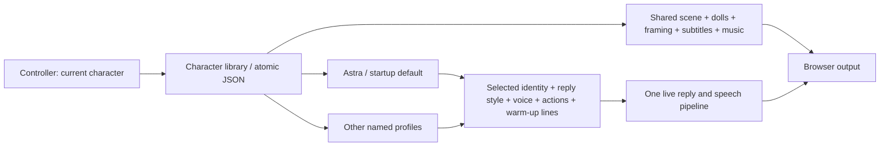

# Architecture review and implementation

Reviewed against the goal: low local compute, direct replies, and a responsive virtual livestream character.

## Current design

```mermaid
flowchart LR
    A[Bilibili or local test input] --> B[Bounded ingress: 100 messages]
    B --> C[0.15 s collection window / at most 10 events]
    C --> D[Safety checks + deduplicate / batch up to 3 viewers]
    D --> E{Intent router}
    E -->|Short greeting or farewell| F[Direct reply template / no LLM]
    E -->|Other messages| G[Cloud API, Ollama, or offline mock]
    F --> H[Text events immediately]
    G --> H
    G --> I[Early sentence TTS / shared progressive audio]
    F --> I
    I --> J[Ordered audio events]
    H --> K[Bounded event queue / WebSocket fan-out]
    J --> K
    K --> L[Controller + browser output]
    L --> M[Canvas sprite or optional VRM / Live2D]
    M --> N[Full scene or transparent OBS browser source]
```

This separation is appropriate for the stated goal. Templates avoid a model call for common short interactions; cloud inference avoids local model hardware; rendering stays in the browser. The server serializes reply production, and memory provides a small rolling context. A new framework or a local video-generation model would add substantial complexity without helping this workflow.

## Implemented changes

- **Chat readback before TTS:** a local bounded extract of the latest selected chat is prepended to the first spoken answer segment only. Displayed text and reply memory remain unchanged; there is no extra LLM call. The Replies toggle also covers chat templates, but not gifts, entry welcomes, or director lines.
- **Voice delivery:** Edge, GLM-TTS, MiMo and MiniMax Turbo share bounded MP3 buffers and browser mouth-sync playback. GLM reuses `GLM_API_KEY`; MiMo uses `MIMO_API_KEY` at Xiaomi's fixed endpoint. Their PCM16 mono SSE chunks are incrementally encoded with `lameenc` (no GPU or external FFmpeg). MiMo uses preset `mimo-v2.5-tts` voices with a separate user-role style instruction; assistant-role content contains only the intended speech. Unsupported numeric tuning controls are hidden for MiMo, and blank direction omits the instruction. Voice design/cloning are excluded because their current endpoints wait for complete generation. Each request snapshots settings; cache keys include provider, voice and MiMo style. Cloud auth/error bodies are not logged, interrupted or malformed streams are not cached, and MiniMax final aggregate packets cannot duplicate playback. GLM and MiMo have been tested with real credentials; MiniMax protocol tests use mocks. Edge remains a manual free option; failures never silently change providers.

- **Reference-based character:** the default silver dragon uses separately painted body, head, hair, wing and arm layers derived from the supplied turnaround. A lightweight Canvas cutout rig animates joints and a small audio-reactive mouth. `neutral.png` remains a fallback. The existing `silver-dragon.vrm` remains available as an approximate optional 3D avatar.
- **Rendering budget:** 30 fps cap, 5 fps when a window is hidden, device pixel ratio capped at 1.5. VRM requests low-power graphics. No local model is required for the default mock demonstration or for cloud API inference.
- **Scene composition:** local palace, garden and moonlit paintings fill the viewport. Cached clouds, up to 150 rain strokes or 40 golden motes render behind the character at at most 20fps and DPR 1.25; hidden tabs and reduced-motion preferences stop atmosphere animation. Static transparent chibi companions share the character group's relative position/scale. A masked CSS backdrop filter adds adjustable bottom softness. Scene settings are validated, saved and broadcast through the same studio settings path. Draft messages are accepted only from the same-origin controller parent in preview mode. Transparent output suppresses scenery, atmosphere, companions and blur. Canvas resize uses untransformed layout dimensions, avoiding compounded scaling.
- **Controller:** stage preview, 2D/VRM preview switch, server telemetry, chat/reply log, character actions, reference viewer, OBS URL copying, and local guide. Identity, Replies, Voice, and Actions panels apply validated settings immediately and persist locally. Voice auditions use draft settings without broadcasting or saving them. Preview is muted by default. Renderer selection applies to the preview; `config.yaml` controls the actual output.
- **Bounded load:** 100 ingress messages (configurable), 10 retained events per collection window, 256 outgoing events, four pending sentence synthesis jobs, 16 pending browser audio segments. Overload retains higher-priority events and newer chat. Drop telemetry includes ingress and window eviction. This is a lossy live interaction queue, not durable paid-event accounting.
- **Broadcast isolation:** clients are sent events concurrently with a one-second send deadline; stalled clients are removed. New clients receive an immediate status snapshot. Active clients receive status every second.
- **Bilibili collector compatibility:** the maintained upstream `blivedm` source is pinned at commit `3bf17fe862b8c2fc6bc04c81c3f0c5db95de93d6` (1.1.7), installed in `.venv`. Its message callbacks are synchronous; they only enqueue work. Web-protocol V2 Protobuf gifts/entries use the SDK parser. Health becomes connected only after a successful AUTH_REPLY. Follow/share/like events do not create entry welcomes; membership value includes quantity. This is still the community web client, not an implemented official Open Live application session.
- **Faster visible replies:** direct/template and non-stream responses display text before waiting for TTS. Audio arrives separately. Streaming LLM output continues using ordered sentence audio.
- **Faster speech delivery:** the browser can read shared MP3 bytes before synthesis finishes. Two synthesis slots, bounded segment buffers, and a 128-entry completed-audio cache limit resource use. Clients share each synthesis instead of making separate provider calls. Fast delivery permits early clause boundaries after 12 characters; natural delivery waits for full sentences. This preserves short phrases instead of fragmenting every comma.
- **Natural voice defaults:** Xiaoxiao female voice with neutral rate and pitch; emotion-based pitch changes are opt-in. Identity has a separate spoken-name pronunciation. Reply style, length, token budget, follow-up questions, direct templates, and motion strength are editable.
- **Validation and errors:** malformed messages and unknown actions return HTTP 422; priority-preserving queue rejection returns 429. Config bounds prevent zero-sized sentence loops. TTS failures surface as a text-only response notice, and partial audio files are removed after failure or cancellation.
- **Playback reliability:** interrupted playback no longer enqueues an undefined URL. Completed audio sources disconnect, output is connected once, autoplay failures retain audio for a user gesture, and reconnect attempts continue with backoff.
- **Stable paths and memory:** config, model, frontend, and audio paths resolve against the project root; `/audio` is mounted on first startup. Memory expires during idle/template-only sessions, snapshots prune expired entries, and mock call history is bounded.

## Defaults and operation

Run `python main.py`, then open `http://127.0.0.1:8000/control`.

For a completely offline visual test, run `python main.py --config config.local-test.yaml` and open `http://127.0.0.1:8001/control`. This separate profile uses mock replies and disables TTS. See [LOCAL_TEST.md](LOCAL_TEST.md) for the two-terminal integration test.

Character choreography is shared by Canvas and VRM in `frontend/static/character-motion.js`. The six demo poses are idle, nod, think, shy, laugh and present. Critically damped springs preserve position and velocity on interruption; post-integration bounds prevent joint overshoot. Feet, skirt, torso scale and global translation stay fixed. The front-view cutout uses only small shoulder/elbow and neck rotations. Painted forearms attach at the slanted upper-arm elbows; each wrist and hand remains one intact piece. Unsupported legacy names map to conservative replacements; manual API requests for removed poses return 422.

`character-face.js` schedules irregular 245ms blinks and blends soft, happy, shy, thoughtful and surprised expressions. `cutout-rig.js` animates the original eye artwork and replaces the painted mouth at calibrated atlas landmarks. Face features inherit the head transform. The Web Audio analyser uses a 1024-sample waveform: DC-corrected RMS, a noise gate, adaptive level normalization, 28ms attack and 55ms release. Spectral balance varies roundness. This is audio-reactive syllable animation, not phoneme recognition. Silent actions, paused/muted/buffering audio and completed speech keep the mouth closed. Body smoothing is bypassed for lips to avoid extra lag.

`/rig-preview` has six held poses, continuous transitions, an automatic tour, expression selection, blink preview, a face close-up and a current-voice test. The voice test calls only TTS and plays locally; it does not broadcast or call the conversation model. Body and face animation need no network service. Rendering retains the 30fps and DPR limits; atlas extraction and eye caches run only at load time.

OBS browser source: `http://127.0.0.1:8000/?overlay=1&controls=0`, normally 1920 × 1080. It uses the saved Scene configuration; add `&transparent=1` to force a transparent character-only output. The regular `/?overlay=1` page includes a fullscreen button that appears when the pointer moves. Use OBS browser-source audio for broadcasting; keep the controller preview muted to avoid duplicate sound.

The normal configuration uses `llm.provider: glm`, model `glm-4-flash-250414`, `live2d.renderer: sprite`, `sprite_dir: avatar_dragon`, a 0.15-second collection window, a 96-token generation budget, and no reply cooldown. It reads `GLM_API_KEY` from `.env` or the environment. The offline profile uses mock replies and no TTS.

Controller settings are now stored in `data/character-profiles.json`, a versioned library containing separate character profiles and one shared scene. On first startup, existing `data/studio-settings.json` values are migrated into the Astra profile without changing them. After migration the library is authoritative; the old flat file is a compatibility export. Alternate YAML configurations have isolated, suffixed libraries. An unreadable existing library stops startup with a recovery message instead of silently replacing saved characters. Credentials remain in `.env` / server configuration and never enter the profile library or public API.

## Character profiles and the shared stage

Local PNG/MP3 imports are handled by `src/media.py`. `POST /api/media/{background|music}` streams a raw file body into a spooled temporary file, enforces byte limits even without Content-Length, then validates format and dimensions/duration off the async event loop. Pillow verifies and decodes static PNGs; Mutagen checks MP3 stream metadata. Original bytes are retained. UUID storage names separate paths from user-visible filenames; per-file JSON metadata is published atomically after the asset is written. Failed writes clean up the newly created partial asset. The library is bounded to 200 files / 1 GB and serialized by a separate upload lock, so upload validation does not hold the live settings/reply lock.

`GET /api/media` returns the shared catalog; `/media/{id}.png` and `/media/{id}.mp3` serve only registered assets, with image/audio MIME types and byte-range support. Scene settings store validated `background_asset` and `music_asset` IDs, never client paths or external URLs. A custom PNG uses the existing background layer, preserving weather, framing and dolls. The music player replaces its source only when the selected track changes, preserving playback through character switches and retaining loop/duck behavior. Uploads initially change the editor draft only; **Apply & save** persists the selection and broadcasts it. Missing/wrong-type asset references are rejected on save. Default music and scenes remain available.

`src/characters.py` owns profile validation, migration, duplication and atomic file replacement. `CharacterProfile` deliberately excludes scene data. A profile contains identity/pronunciation, reply settings, all supported voice settings, action mapping/intensity, and quiet-room timing and lines. `artwork_id` is an explicit binding to the installed artwork pack. Only `astra` is currently supported: the standing rig is Astra-specific, and the car painting includes Astra and the dolls. Creating an identity is therefore not equivalent to generating a new visual avatar. Future artwork packs need their own calibrated rig/face assets and a renderer resolver; keep the shared stage schema independent of those assets. The existing car shot would need separate cabin/body layers to support different visible drivers.

`GET /api/characters` lists non-secret profile summaries. `POST /api/characters` duplicates a selected profile under a unique ID; `POST /api/characters/activate` selects it. Astra remains the startup default regardless of the last selection. `/api/studio` continues to expose the active profile combined with the shared stage, keeping old integrations compatible. New controller saves include `X-Profile-ID` and `X-Profile-Revision`; conflicting edits receive HTTP 409. Create/activate requests also require a revision. Legacy saves without these headers remain accepted for existing scripts and should only be used by a single writer.

One settings lock serializes library mutations; the reply lock protects prompt/voice replacement. Switching is rejected while a reply or background reply is preparing. A successful switch closes the previous TTS engine and cancels its progressive jobs, clears its warm-up bag and previous assistant replies, and preserves viewer memory, gift buffers, the platform connection and session metrics. A `settings_updated` WebSocket event clears old browser voice queues and subtitles, applies the new profile, and reuses the existing music player and scene. Initial WebSocket snapshots contain the current settings too, so reconnecting output catches a missed switch. The controller keeps unsaved drafts and blocks switching until they are saved or discarded.

## Verification

- Python unit/API/WebSocket tests: `python -m unittest discover -s tests -v`.
- Browser audio queue regressions: `npm test`.
- VRM bundle: `npm run build:vrm`.
- Live model + speech: `python scripts/test_glm_voice.py` with the normal server running.
- Real end-to-end first text/audio bytes: `python scripts/benchmark_latency.py --runs 3`; results go to `data/qa/latency-after.json`. This includes intake and network time. The controller's FIRST AUDIO metric starts at reply generation, so it excludes collection and queue wait. First received bytes precede audible playback, which also depends on browser buffering.
- Manual browser checks: local connection, greeting/reply activity, action buttons, 2D/VRM switching, character reference, and responsive layout.

## Remaining limits

- Real Bilibili collection needs a configured room and network access; the user was not streaming during the 2026-10-26 check. Offline SDK packet replay and local API tests passed, but live authorization/delivery and OBS streaming were not tested. Official Open Live requires developer credentials, App ID, streamer identity code, signed start/heartbeat/end requests, WebSocket authentication, `open_id` identity mapping, and handling of session-end and withdrawn paid messages; this path is not wired into the project yet. The general OpenHome platform is a separate integration and must not be mixed with Open Live. Real cloud/local inference needs an available model endpoint.
- Edge TTS is an external service. Its latency is separate from the collection window; text is delivered first when voice synthesis is slow or unavailable.
- Reply production is serialized on the server; audible playback is queued independently per browser. The server does not receive playback acknowledgements or guarantee paid-event delivery during overload. High-volume paid interactions would benefit from a durable event scheduler and playback-aware admission before production use.
- The supplied image is a turnaround. The derived 2D cutout rig supports front-view joint movement; fingers retain their painted hand shape. Large turns, facial morphs and physical fabric simulation need further artwork or a more detailed rig. The optional existing VRM has a simpler mesh and cannot reproduce every costume detail.
- Keyword moderation is a basic gate. Keep the current loopback host for a local controller; hosted multi-user operation would require authentication and stronger operational controls.
