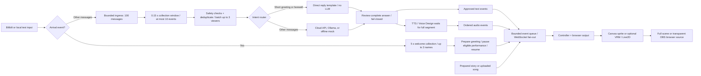
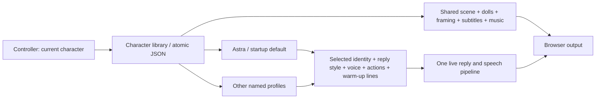

# Architecture review and implementation

Reviewed against the goal: low local compute, direct replies, and a responsive virtual livestream character.

Shared product requirements: [requirement_basic.md](requirement_basic.md). Song
requirements and the complete preparation workflow:
[requirement_song.md](requirement_song.md). Operator startup:
[START_HERE.md](START_HERE.md).

## Current design



This separation is appropriate for the stated goal. Templates avoid a model call for common short interactions; cloud inference avoids local model hardware; rendering stays in the browser. The server serializes reply production, and memory provides a small rolling context. A new framework or a local video-generation model would add substantial complexity without helping this workflow.

## Implemented changes

- **Chat readback before TTS:** a local bounded extract of the latest selected chat is prepended to the first spoken answer segment only. Displayed text and reply memory remain unchanged; there is no extra LLM call. The Replies toggle also covers chat templates, but not gifts, entry welcomes, or director lines.
- **Voice delivery:** Edge, GLM-TTS, MiMo and MiniMax Turbo share bounded MP3 buffers and browser mouth-sync playback. MiMo speech now defaults to `mimo-v2.5-tts-voicedesign`: a non-empty user-role voice description is required, the preset `audio.voice` is omitted, and `audio.optimize_text_preview` is false to preserve the supplied assistant-role script. Its compatibility SSE interface returns audio after complete inference, so it provides no early-audio latency benefit. The optional preset `mimo-v2.5-tts` remains separate and is the only MiMo endpoint used by experimental singing. Voice cloning is not implemented. PCM16 mono chunks use `lameenc`; cache identity includes model, voice and style. Each request snapshots settings, failures expose sanitized diagnostics, malformed/interrupted audio is not cached, and no provider is silently substituted.

- **Reference-based character:** the default silver dragon uses separately painted body, head, hair, wing and arm layers derived from the supplied turnaround. A lightweight Canvas cutout rig animates joints and a small audio-reactive mouth. `neutral.png` remains a fallback. The existing `silver-dragon.vrm` remains available as an approximate optional 3D avatar.
- **Rendering budget:** 30 fps cap, 5 fps when a window is hidden, device pixel ratio capped at 1.5. VRM requests low-power graphics. No local model is required for the default mock demonstration or for cloud API inference.
- **Scene composition:** local palace, garden and moonlit paintings fill the viewport. Cached clouds, up to 150 rain strokes or 40 golden motes render behind the character at at most 20fps and DPR 1.25; hidden tabs and reduced-motion preferences stop atmosphere animation. Static transparent chibi companions share the character group's relative position/scale. A masked CSS backdrop filter adds adjustable bottom softness. Scene settings are validated, saved and broadcast through the same studio settings path. Draft messages are accepted only from the same-origin controller parent in preview mode. Transparent output suppresses scenery, atmosphere, companions and blur. Canvas resize uses untransformed layout dimensions, avoiding compounded scaling.
- **Controller:** stage preview, 2D/VRM preview switch, server telemetry, chat/reply log, character actions, reference viewer, OBS URL copying, and local guide. Identity, Replies, Voice, and Actions panels apply validated settings immediately and persist locally. Voice auditions use draft settings without broadcasting or saving them. Preview is muted by default. Renderer selection applies to the preview; `config.yaml` controls the actual output.
- **Bounded load:** 100 ingress messages (configurable), 10 retained events per collection window, 256 outgoing events, four pending sentence synthesis jobs, 16 pending browser audio segments. Overload retains higher-priority events and newer chat. Drop telemetry includes ingress and window eviction. This is a lossy live interaction queue, not durable paid-event accounting.
- **Broadcast isolation:** clients are sent events concurrently with a one-second send deadline; stalled clients are removed. New clients receive an immediate status snapshot. Active clients receive status every second.
- **Bilibili collector compatibility:** the maintained upstream `blivedm` source is pinned at commit `3bf17fe862b8c2fc6bc04c81c3f0c5db95de93d6` (1.1.7), installed in `.venv`. Its message callbacks are synchronous; they only enqueue work. Web-protocol V2 Protobuf gifts/entries use the SDK parser. Health becomes connected only after a successful AUTH_REPLY. Follow/share/like events do not create entry welcomes; membership value includes quantity. This is still the community web client, not an implemented official Open Live application session.
- **Faster visible replies:** direct/template and non-stream responses display text before waiting for TTS. Audio arrives separately. Streaming LLM output continues using ordered sentence audio.
- **Faster speech delivery:** the browser can read shared MP3 bytes before synthesis finishes. Two synthesis slots, bounded segment buffers, and a 128-entry completed-audio cache limit resource use. Clients share each synthesis instead of making separate provider calls. Fast delivery permits early clause boundaries after 12 characters; natural delivery waits for full sentences. This preserves short phrases instead of fragmenting every comma.
- **Natural voice defaults:** Xiaoxiao female voice with neutral rate and pitch; emotion-based pitch changes are opt-in. Identity has a separate spoken-name pronunciation. Reply style, length, token budget, follow-up questions, direct templates, and motion strength are editable.
- **Validation and errors:** malformed messages and unknown actions return HTTP 422; priority-preserving queue rejection returns 429. Config bounds prevent zero-sized sentence loops. TTS failures surface as a text-only response notice, and partial audio files are removed after failure or cancellation.
- **Playback reliability:** interrupted playback no longer enqueues an undefined URL. Completed audio sources disconnect, output is connected once, autoplay failures retain audio for a user gesture, and reconnect attempts continue with backoff.
- **Stable paths and memory:** config, model, frontend, and audio paths resolve against the project root; `/audio` is mounted on first startup. Memory expires during idle/template-only sessions, snapshots prune expired entries, and mock call history is bounded.

## Defaults and operation

Run `python main.py`, then open `http://127.0.0.1:8000/control`.

For a completely offline visual test, run `python main.py --config config.local-test.yaml` and open `http://127.0.0.1:8001/control`. This separate profile uses mock replies and disables TTS. See [LOCAL_TEST.md](LOCAL_TEST.md) for the two-terminal integration test.

Character choreography is shared by Canvas and VRM in `frontend/static/character-motion.js`. The six demo poses are idle, nod, think, shy, laugh and present. Critically damped springs preserve position and velocity on interruption; post-integration bounds prevent joint overshoot. Feet, skirt, torso scale and global translation stay fixed. The front-view cutout uses only small shoulder/elbow and neck rotations. Painted forearms attach at the slanted upper-arm elbows; each wrist and hand remains one intact piece. Unsupported legacy names map to conservative replacements; manual API requests for removed poses return 422.

`character-face.js` schedules irregular 245ms blinks and blends soft, happy, shy, thoughtful and surprised expressions. `cutout-rig.js` animates the original eye artwork and replaces the painted mouth at calibrated atlas landmarks. Face features inherit the head transform. The Web Audio analyser uses a 1024-sample waveform: DC-corrected RMS, a noise gate, adaptive level normalization, 28ms attack and 55ms release. Spectral balance varies roundness. This is audio-reactive syllable animation, not phoneme recognition. Silent actions, paused/muted/buffering audio and completed speech keep the mouth closed. Body smoothing is bypassed for lips to avoid extra lag.

`/rig-preview` has six held poses, continuous transitions, an automatic tour, expression selection, blink preview, a face close-up and a current-voice test. The voice test calls only TTS and plays locally; it does not broadcast or call the conversation model. Body and face animation need no network service. Rendering retains the 30fps and DPR limits; atlas extraction and eye caches run only at load time.

OBS browser source: `http://127.0.0.1:8000/?overlay=1&controls=0`, normally 1440 × 1080 (4:3). It uses the saved Scene configuration; add `&transparent=1` to force a transparent character-only output. The regular `/?overlay=1` page includes a fullscreen button that appears when the pointer moves. Use OBS browser-source audio for broadcasting; keep the controller preview muted to avoid duplicate sound.

The normal configuration uses `llm.provider: glm`, primary model `glm-4.7-flash`, and fallback order `glm-4-flash-250414 → glm-4-flashx-250414 → glm-4-air-250414 → glm-4.5-air → glm-4.7-flashx`. Reasoning-capable GLM requests explicitly disable thinking; older plain GLM-4 models do not receive unsupported thinking parameters. First usable text is bounded to three seconds per attempt and twenty seconds overall, with a ninety-second failed-model cooldown. Fallback is allowed before text is yielded, not by splicing a failed partial stream into a different model's answer. Authentication, certificate and content-review failures stop the request. The project uses `live2d.renderer: sprite`, `sprite_dir: avatar_dragon`, a 0.15-second collection window, a 96-token generation budget, and no reply cooldown. It reads `GLM_API_KEY` from the private API store, `.env` or the environment. The offline profile uses mock replies and no TTS.

Controller settings are now stored in `data/character-profiles.json`, a versioned library containing separate character profiles and one shared scene. On first startup, existing `data/studio-settings.json` values are migrated into the Astra profile without changing them. After migration the library is authoritative; the old flat file is a compatibility export. Alternate YAML configurations have isolated, suffixed libraries. An unreadable existing library stops startup with a recovery message instead of silently replacing saved characters. Credentials remain in `.env` or the private local API store and never enter the profile library or public API.

## API connections and network routing

`src/api_settings.py` keeps validated text/MiMo connections and provider-specific keys in `data/.env.api-studio-settings.json`, excluded by the existing `.env.*` Git rule. Server startup applies these overrides after character settings. Blank keys preserve prior credentials; GLM-TTS inherits the stored GLM text key unless explicitly overridden. Public views expose configured flags only. Model dumps exclude inline LLM secrets and TTS private key overrides.

`src/api_routes.py` provides local-only `/api/connections` read/save and draft tests. Saves require same-origin headers, a revision match and an idle reply/preview pipeline; the private file is replaced atomically before swapping runtime clients. Validation errors suppress secret input echoes. No credentials enter WebSocket events. A draft test uses a disposable client, one short request and a 25-second limit, without saving, broadcasting or playing audio. Character switching preserves shared connections.

`src/provider_network.py` selects Direct, environment proxy routing, or Auto (environment then Windows manual HTTP proxy then Direct). It never changes VPN settings, follows PAC scripts, or retries across account endpoints. Error categories expose HTTP status, DNS/proxy/TLS/timeout failures without raw headers, URLs or provider bodies. GLM 4.5+ uses its explicit thinking field for both streaming and non-streaming requests; it never retries without that field. See [BigModel thinking control](https://docs.bigmodel.cn/cn/guide/capabilities/thinking-mode) and [MiMo account-region FAQ](https://mimo.mi.com/docs/zh-CN/quick-start/faq/account). Current-US-connection tests do not establish non-US availability.

## Character profiles and the shared stage

Local PNG/MP3 imports are handled by `src/media.py`. `POST /api/media/{background|music}` streams a raw file body into a spooled temporary file, enforces byte limits even without Content-Length, then validates format and dimensions/duration off the async event loop. Pillow verifies and decodes static PNGs; Mutagen checks MP3 stream metadata. Original bytes are retained. UUID storage names separate paths from user-visible filenames; per-file JSON metadata is published atomically after the asset is written. Failed writes clean up the newly created partial asset. The library is bounded to 200 files / 1 GB and serialized by a separate upload lock, so upload validation does not hold the live settings/reply lock.

`GET /api/media` returns the shared catalog; `/media/{id}.png` and `/media/{id}.mp3` serve only registered assets, with image/audio MIME types and byte-range support. Scene settings store validated `background_asset` and `music_asset` IDs, never client paths or external URLs. A custom PNG uses the existing background layer, preserving weather, framing and dolls. The music player replaces its source only when the selected track changes, preserving playback through character switches and retaining loop/duck behavior. Uploads initially change the editor draft only; **Apply & save** persists the selection and broadcasts it. Missing/wrong-type asset references are rejected on save. Default music and scenes remain available.



`src/characters.py` owns profile validation, migration, duplication and atomic file replacement. `CharacterProfile` deliberately excludes scene data. A profile contains identity/pronunciation, reply settings, all supported voice settings, action mapping/intensity, quiet-room timing and lines, a `modules` presentation map, and `module_options` for validated module-specific policies. `artwork_id` is an explicit binding to the installed artwork pack. Only `astra` is currently supported: the standing rig is Astra-specific, and the car painting includes Astra and the dolls. Creating an identity is therefore not equivalent to generating a new visual avatar. Future artwork packs need their own calibrated rig/face assets and a renderer resolver; keep the shared stage schema independent of those assets. The existing car shot would need separate cabin/body layers to support different visible drivers.

`GET /api/characters` lists non-secret profile summaries. `POST /api/characters` duplicates a selected profile under a unique ID; `POST /api/characters/activate` selects it. Astra remains the startup default regardless of the last selection. `/api/studio` continues to expose the active profile combined with the shared stage, keeping old integrations compatible. New controller saves include `X-Profile-ID` and `X-Profile-Revision`; conflicting edits receive HTTP 409. Create/activate requests also require a revision. Legacy saves without these headers remain accepted for existing scripts and should only be used by a single writer.

One settings lock serializes library mutations; the reply lock protects prompt/voice replacement. Switching is rejected while a reply or background reply is preparing. A successful switch closes the previous TTS engine and cancels its progressive jobs, clears its warm-up bag and previous assistant replies, and preserves viewer memory, gift buffers, the platform connection and session metrics. A `settings_updated` WebSocket event clears old browser voice queues and subtitles, applies the new profile, and reuses the existing music player and scene. Initial WebSocket snapshots contain the current settings too, so reconnecting output catches a missed switch. The controller keeps unsaved drafts and blocks switching until they are saved or discarded.

## Character modules and finite performances

`src/modules/` defines an explicit module boundary. `ModuleSpec` registers a trusted local service factory, optional API router, controller script, output adapter, and supported pose/expression choices. The server installs registered routes, starts services in order, and closes them in reverse order; failed startup also unwinds services. Chat owns the conversation pipeline, Songs owns the local recording library and optional experimental generation, and Stories owns tagged story scripts, prepared clips and triggers. `/api/modules` supplies the shelf and stage adapters, so another module does not require a new hard-coded controller card or output event-switch branch.

Each character has a `modules` presentation map. Chat, Songs and Stories save separate poses, expression types, movement strength and `scene_preset`. `inherit` uses the shared stage; an explicit preset overrides presentation only for that module without rewriting shared scene settings. Songs defaults to `singing-room` when this field is absent, while Chat inherits the shared car by default. Old libraries load their defaults, profile copies remain independent, and ordinary identity/voice saves preserve both `modules` and `module_options`. Story policies are validated by `StoryPolicy` before entering `module_options.story`. Module saves use active-character and revision checks. Scene assets, companions, BGM, credentials and artwork bindings remain separate. Artwork bindings remain Astra-specific; the new microphone presentation is an additional Astra view, not a general new-character renderer.

`AudienceIntentPolicy` validates `module_options.interaction` independently of module presentation. The Modules controller edits semantic interaction, scene narration, vote thresholds/windows and cooldowns for the active character through `/api/interactions`, with profile/revision checks. Its live counters do not overwrite an unsaved form. Temporary requests and selection state remain in memory rather than in the character file.

`StageActivity` gives one performance exclusive stage ownership and exposes an idle event to chat. A module cannot release another module's ownership. `PerformanceSession` in `src/performance.py` provides a shared timestamped start, bounded fallback timer, token-checked completion acknowledgement, Stop and shutdown lifecycle. Both a browser audio-ended acknowledgement and the fallback can release ownership; obsolete acknowledgements cannot stop a newer performance. Every completed finite performance returns to Chat and restores shared music/presentation. Initial WebSocket `module_snapshots` restore the current performance after reconnecting.

To add an installed module:

1. Implement a service with optional `start()`, `close()`, `module_status()`, and optionally `snapshot()` / `default_presentation(profile)`. A finite prepared-audio service can derive from `PerformanceSession`. Own its validated `APIRouter` and access it through `request.app.state.modules.service(id)`.
2. Register its `ModuleSpec` in `src/modules/builtin.py`, including local scripts, API router and supported presentation choices. Restart Studio after installing code.
3. Register the controller with `StudioModules.registerController(id, factory)` and return an object with `open()`. The shelf creates the card and common pose/face editor; the module supplies its own content UI.
4. Register an optional stage adapter with `StudioModules.registerOutput(id, async client => adapter)`. It can implement `handle`, `frame`, `unlock`, `setMuted`, `dispose`, plus `active` and `voice` getters. `frontend/static/modules/performance-output.js` is the shared audio/interrupt/restore adapter used by Songs and Stories. Only the current vocal analyser supplies mouth data. Bounded rig joint limits and reduced-motion preferences continue to apply.

This is an installed source-code extension interface. New visual poses outside the calibrated rig still need compatible artwork/renderer support. Existing chat endpoints remain compatible, with pipeline lifecycle managed by Chat.

## Voice design and prepared housemate stories

`src/story_catalog.py` contains ten original fictional, funny slice-of-life stories featuring only **Astra, Claude and DeepSeek** as human-like housemates. The current titles and operator controls are listed in [START_HERE.md](START_HERE.md). `src/story.py` sends the complete tagged story as assistant content and **the exact current saved profile voice description**, unchanged, as user content to **`mimo-v2.5-tts-voicedesign`**. It no longer appends an adult role, another speaker, scene or delivery description to the voice-design prompt. Acting cues remain inside the story text. Chat, auditions and stories therefore share the same speaker-design prompt. Voice Design requires a description, excludes preset voices/singing, and currently returns compatibility SSE audio only after the whole inference completes. `optimize_text_preview=False` prevents deliberate script rewriting. See [MiMo's official model and streaming guidance](https://mimo.mi.com/docs/zh-CN/quick-start/usage-guide/audio/speech-synthesis-v2.5).

Prepared audio is stored under `data/stories/<profile-id>/`. The voice signature includes prompt version **`profile-voice-v2`**, model and saved description; the clip ID also includes profile and story text. This invalidates the earlier clips that used extra speaker/scene instructions. Unchanged current recordings reuse files, while a changed description requires matching new clips. Generation snapshots settings, runs sequentially, uses partial files plus atomic metadata publication, supports cancellation and keeps per-story sanitized errors. Each request has a 240-second deadline, an 8 MiB MP3 limit and a 300-second duration cap. Playing a prepared story makes no TTS or conversation-model call.

`src/story_routes.py` and `story-controls.js` expose the ten scripts, preparation/cancellation, audition, selected/random playback, Stop and trigger policies. Random selection shuffles the ready stories without repeats during a round and avoids the previous story at a round boundary. Only prepared clips are eligible. Viewer commands such as “讲个故事”, “换个故事” and “停止故事” are intercepted before the ordinary LLM queue. Play/change requests default to a 45-second cooldown; an active story is not restarted by another play request. The optional idle trigger starts disabled, waits 120 seconds without viewer activity, and defaults to a 600-second interval between automatic stories. Viewer-quiet time is tracked separately from AI warm-up activity.

The catalog resolves ready clips by current character, script and saved voice signatures. Earlier preparation reports and durations describe their original text/voice versions; they do not establish readiness or latency for the rewritten trio stories. Use current catalog status and metadata for each clip. Preparing missing stories calls the voice provider; replaying a matching prepared recording is local.

## Audience welcomes and unfinished-story resume

`src/welcome.py` is a bounded arrival collector attached to ingress rather than the paused conversation queue. Defaults collect arrivals for 5 seconds, name at most 3 selected viewers, group remaining arrivals in the same welcome, enforce at least 15 seconds between batches and avoid repeatedly naming the same viewer for 300 seconds. Pending names are bounded to 1,000 and the cooldown map to 4,000. Sanitized names enter fixed welcome wording rather than LLM instructions. Normal Chat also uses this welcome path.

The collector prepares welcome audio while the story continues. Once it is ready, `PerformanceSession.welcome()` suspends the story's finish timer and broadcasts an interrupt with performance/welcome IDs. The browser records the current local audio position, pauses only its existing sources, plays the welcome through the same presentation/audio lifecycle, then acknowledges the welcome. The server shifts the performance clock by the paused interval and re-arms the finish fallback; the output resumes from its saved offset. Story text is not regenerated. If the output cannot acknowledge, a bounded welcome fallback resumes it. Stop releases a paused story as well. During Songs, arrivals are suppressed rather than queued for later welcome playback.

`module_snapshots` include paused/welcome state for reconnecting outputs. Thumbnails remain silent and do not send completion acknowledgements. The shared adapter supplies welcome-vocal analysis while the interlude is active, then restores story analysis and the story's selected presentation. Ordinary chat remains buffered according to the existing bounded queue policy until the finite performance returns to Chat.

## Uploaded songs and offline voice conversion

Uploaded recordings are now the primary Songs workflow. `src/singing_routes.py` imports a validated shared-media MP3 into the current character's song library, limited to **20 MiB / 600 seconds**. The source is labeled `upload` / `recorded-audio`, and playback makes no TTS request. Optional vocal-only guides must be at most 20 MiB and within two seconds of the recording's duration, starting at the same point. The full mix plays once, while the guide reaches a silent analyser path for mouth motion. Without a guide, the full mix's level approximates mouth motion and accompaniment can also open the mouth.

`singing-player.js` preloads source/backing/guide tracks and schedules them on one Web Audio clock. A separate backing track remains outside the mouth analyser; late outputs seek to the elapsed position. Quiet/accompaniment modes pause shared music without releasing the capture session; shared mode keeps the music with vocal ducking. Stop/end restores the Chat presentation and previous music configuration. Visual BPM changes bounded visual sway only, never audio tempo. The car's painted hand/body contacts remain fixed. Attached LRC cues are selected using actual recording position minus vocal delay and the saved lyric offset; blank cues clear captions during gaps. Pauses, late joins and lyric-setting updates retain the same recording clock. Songs without timed lyrics show their title.

The old generated mini-songs/test takes are retained but hidden by default behind the “show experimental tracks” option. Experimental generation explicitly forces **preset `mimo-v2.5-tts`**, prepends `(唱歌)` and remains limited to 1,800 lyric characters, 240 seconds/request and 300 seconds of audio. Voice Design is never used for singing. The earlier long test's 48.1% ASR character alignment suggested skipped lyrics and did not establish musical pitch/rhythm quality; no accurate-cover claim is made.

Catalogs and exports are character-scoped. `/api/singing/backup` writes an atomic ZIP with recording/metadata files, optional guide files, a SHA-256 manifest and restore instructions; local download checks apply. It excludes API keys, identity settings, shared music and separate accompaniment. The library holds 64 takes per character (256 total), up to 1 GB of audio/guide files, and up to eight ZIP backups per character. The earlier `prepare_astra_song_library.py` remains a historical experimental generator, not the recommended song workflow.

Bilibili source recordings remain under `data/song-sources/`; `download-results.json` records their provenance and local files. Five full recordings have completed conversion, mix export and library import at **50 diffusion steps**: 起风了 `BV1D64y1Z7Ko`, 小幸运 `BV1y82uB2ET4`, 告白气球 `BV1A3411J7HX`, 大鱼 `BV1f59QBGEhx` and 海屿你 `BV14nrkBPEBE`. Their complete batch metadata is archived under `data/songs-converted/batches/20261028-new3/previous-completed-batch/`. 起风了 and 小幸运 are currently allowed, with saved default LRCs; the other three are temporarily blocked for requests and manual playback while their files remain intact. The current `sources.json`, `jobs.json` and `pipeline-state.json` describe the separately started three-recording batch: I Really Want to Stay at Your House `BV1FN411n7FT`, new 海屿你 `BV14GovBnESm`, and 泡沫 `BV1y8411i7Dd`, using the same approved voice, 50 steps and three workers. These new recordings are still in preparation; the earlier five are not reconverted. Preparation manifests are not a live request queue and do not themselves filter song bans.

The approved target follows Astra's **current saved profile prompt**, also used by chat and stories. `data/voice-references/astra-current-voice.wav` is an 18.936-second mono 24 kHz PCM16 reference. Its JSON sidecar records the exact prompt, approval, model and SHA-256; the SVC input uses the first eight seconds of this same voice. Earlier B/reference files are historical alternatives. The four-second [current-voice song preview](data/qa/current-voice-song-preview.json) is an excerpt validation, not a completed full song.

`scripts/prepare_astra_songs.py` owns the locked pipeline: start/resume with `--steps 50 --workers 1 --threads-per-worker 6`, inspect with `--status`, and request a stop with `--stop`. It starts the separator and converter as isolated child processes, monitors their state, exports validated mixes and guides, then imports the completed active batch. Stop terminates its owned Windows process trees; source/reference/settings fingerprints and saved conversion chunks permit validated work to resume. It continuously checks that the approved reference hash and saved profile voice still match the batch. `pipeline-state.json` feeds the Songs dialog's preparation stage/count/title/estimate through `/api/singing/preparation`.

`scripts/separate_song_sources.py` decodes the original M4A into lossless 44.1 kHz stereo, then uses Demucs 4.1.0 `htdemucs` to create aligned FLOAT `vocals.wav` and `accompaniment.wav`. It preserves relative levels without independent stem normalization. Shape, finite values, source-relative amplitude, mixture reconstruction, sample counts and hashes are checked before ready metadata is published. Audio-duration references are used for length checks; video runtime is metadata only, and decoded WAV sample count is authoritative. `scripts/seed_vc_batch.py` converts only the vocal stem with [Seed-VC](https://github.com/Plachtaa/seed-vc), source F0 conditioning, unchanged duration, no automatic F0 shift and zero semitone shift. Chunk state includes overlap/RNG data and the source/reference/settings fingerprint. The source melody, including existing errors, is retained.

`scripts/export_converted_songs.py` remixes the converted vocal with the accompaniment and publishes the MP3 plus an aligned vocal-only lip guide in `prepared.json`. The local import API derives the active IDs and requested quality from `jobs.json`, requires the entire selected batch, verifies voice/reference/settings and files, then imports missing takes and backs up the resulting character library. It checks the current in-memory Astra voice under the settings lock and waits for a safe import window. Import changes neither the active character nor stage playback. `scripts/import_prepared_songs.py` provides the corresponding offline path only after verifying the server is stopped. The low-level `convert_song_voice.py` remains available for single-source planning; its semitone option requires conversion inference and is not an instant live transpose feature.

`src/lyrics.py` parses bounded LRCs, locally reviews text through the singing service, and atomically stores cues/offsets in song metadata. `src/lyric_alignment.py` builds offline recognition anchors; `src/lyric_match.py` validates monotonic matching and robust timing fits against supplied reference lyrics. The operator scripts preserve source/reference hashes, skip banned songs and retain existing LRCs unless replacement is explicitly requested. No recognition or remote lookup occurs during playback. 起风了's default timestamps use a near-unity scale to prevent drift; 小幸运 uses a fixed offset. Timing estimates are not a claim of word-by-word manual verification. See [requirement_song.md](requirement_song.md) for measured corrections, command order and preserved reference files.

Explicit `jobs.replace_titles` selects normalized titles from the validated incoming batch for replacement. The import helper first creates and verifies a full pre-replacement backup, publishes the new takes, then quarantines retired metadata/audio/guides outside the active library with a recovery receipt. Ordinary publication errors roll back owned changes; process interruption retains the backup and receipt for recovery. Exact-version reimports preserve existing LRCs, while new recording versions start without stale timing data. The live API waits for finite stage activity to end before replacement and strips private backup/archive paths from its response. The offline CLI uses repeated `--replace-title`. Neither path changes character bans or starts playback.

### Singing-room presentation

`ModulePresentation.scene_preset` and the common **Scene · 模块场景** editor now support `singing-room`, selected by default for Songs. Presentation temporarily resolves a separate night music room with a transparent microphone-holding Astra and reused DeepSeek/Claude dolls; leaving Songs restores Chat's inherited shared car. It does not replace the persisted shared scene or create a separate BGM library.

`singing-scene.js` draws a single transparent, calibrated Astra painting over the separate room. The v2 ivory/lilac gaming outfit preserves the reference identity. The tabletop clips the lower body and non-microphone hand; seated happy doll sprites replace the standing/bowing variants in this view. A bounded 384-triangle mesh keeps the microphone/gripping hand rigid under a shared upper-body parent, anchors the hidden seated base and supports gentle recording-position sway/head/arm motion. Shared texture margins prevent antialiased mesh seams. Local idle breathing uses a separate visible-frame clock with up to ten source pixels of connected upper-body lift; the desktop remains fixed. Pausing freezes musical sway while breathing continues; ending eases the pose to rest. Blinks close along calibrated tilted eye axes, and semantic emotion targets distinguish lids, brow tension, mouth curvature and blush while respecting enabled/intensity settings. Lips use only the actual audio envelope, including intro speech. A standalone silent rehearsal at `/static/previews/singing-motion.html` does not connect to the live output. Hidden/reduced-motion states suppress body motion. Geometry, audio-clock and scene-restoration tests pass, and the revised composition was inspected in the local output. This remains a limited painted rig, with no arbitrary new gestures or phoneme recognition.

The previous benchmark schedule used **one six-thread converter alongside one four-thread separator**. The active 2026-10-28 three-song batch requests **three four-thread converters and one four-thread separator**. The requested worker ceiling is 12, bounded further by active tracks and available memory. In the real short-clip [parallel evaluation](data/qa/profiling/seed-vc-parallel-evaluation.json), one six-thread converter took 70.30 seconds for four seconds of audio; two four-thread converters took 158.74 seconds for eight seconds combined, about **11.4% lower throughput**. The [stage profile](data/qa/profiling/seed-vc-stage-profile.json) attributed 77.4% to diffusion and 16.5% to the vocoder. Worker count leaves the requested 50-step conversion quality unchanged. These are short-run measurements rather than full-song completion estimates.

The installed `.tools/seed-vc` models and `.venv-svc` runtime remain separate from the live application. **Torch/torchaudio 2.4.1 CPU** fixes the reproduced Windows 2.4.0 numerical regression; the main `.venv` was unchanged. Proofs are [CPU math checks](data/qa/cpu-math-torch241.json), [separation QA](data/qa/demucs-setup.json) and [SVC setup](data/qa/seed-vc-setup.json). This Intel UHD 770 machine has no detected NVIDIA GPU. Model preparation remains offline, followed by local file playback in the stream.

## Verification

### Live music capture

`scene.music_source` selects `file` (backward-compatible default) or `system`. The saved choice is shared across characters; capture permission and live tracks are deliberately ephemeral. `MusicCaptureControls` opens a user-gesture `getDisplayMedia` picker in the controller, requests isolated tab/window audio and local-playback suppression, rejects whole-monitor captures and streams without audio, disables the required video track, and sends only audio tracks to `MusicBridge`. The hidden video is neither rendered nor transmitted. The controller never monitors its captured audio locally.

`/ws/music` in `src/music_capture.py` is a same-origin, audio-only signaling hub with one publisher and up to eight outputs. It forwards bounded offer/answer descriptions, never audio bytes; captured data is not written to disk. `MusicBridge` uses host ICE candidates without external STUN/TURN, reconnects signaling and renegotiates peers after outages, and tears down peers/tracks on stop or page exit. Each non-preview, enabled, unmuted `StageMusic` subscribes independently and attaches the received stream to its existing music player, retaining volume and speech ducking without feeding the lip-sync analyser. File playback and capture are mutually exclusive. No unsupported-browser fallback silently plays the old file in capture mode.

The controller must stay open, browser permissions must be reselected after reload, and the browser must support audio capture for the chosen surface. App window audio is not universally available. Original source audio can still be captured separately by an external desktop mixer, so users must keep a single audio route. This local unauthenticated studio should remain on loopback; the origin check does not turn it into a public multi-user streaming service.

- Python unit/API/WebSocket tests: `python -m unittest discover -s tests -v`.
- Browser audio queue regressions: `npm test`.
- VRM bundle: `npm run build:vrm`.
- Live model + speech: `python scripts/test_glm_voice.py` with the normal server running.
- Real end-to-end first text/audio bytes: `python scripts/benchmark_latency.py --runs 3`; results go to `data/qa/latency-after.json`. This includes intake and network time. The controller's FIRST AUDIO metric starts at reply generation, so it excludes collection and queue wait. First received bytes precede audible playback, which also depends on browser buffering.
- Manual browser checks: local connection, greeting/reply activity, action buttons, 2D/VRM switching, character reference, and responsive layout.

## Remaining limits

- Real Bilibili collection needs a configured room and network access. The user confirmed receiving a reply to real room chat and hearing voice with Bilibili's meter moving; this does not establish complete paid-event delivery or official API authorization. Official Open Live requires developer credentials, App ID, streamer identity code, signed start/heartbeat/end requests, WebSocket authentication, `open_id` identity mapping, and handling of session-end and withdrawn paid messages; this path is not wired into the project yet. The general OpenHome platform is a separate integration and must not be mixed with Open Live. Real cloud/local inference needs an available model endpoint.
- Edge TTS and the other speech providers require external services. Their latency is separate from the collection window; approved stage subtitles follow actual voice playback rather than early synthesis preparation.
- Reply production is serialized on the server; audible playback is queued independently per browser. Finite performance/welcome sessions now receive token-checked playback acknowledgements, but ordinary chat audio still has no playback-aware admission or guaranteed paid-event delivery during overload. High-volume paid interactions would benefit from a durable event scheduler and playback-aware admission before production use.
- The supplied image is a turnaround. The derived 2D cutout rig supports front-view joint movement; fingers retain their painted hand shape. Large turns, facial morphs and physical fabric simulation need further artwork or a more detailed rig. The optional existing VRM has a simpler mesh and cannot reproduce every costume detail.
- Keyword moderation is a basic gate. Keep the current loopback host for a local controller; hosted multi-user operation would require authentication and stronger operational controls.


## Local security and broadcast review (2026-10-27)

The server is a loopback studio, not a remotely authenticated control service.
`TrustedHostMiddleware` limits Host to `localhost`, `127.0.0.1` and `[::1]`.
Private reads and writes declare `Depends(local_request)`: loopback peer, exact
same Origin/port, Fetch Metadata and `X-Studio-API: 1`. WebSockets require the
exact local Origin before accepting. Media uses the same local boundary without
the custom header needed by fetch, so audio/image elements continue to work.
There is no CORS allowance for arbitrary sites and no external forwarding of
credentials. This boundary does not defend against already-authorized local code.

Viewer names, messages and rendered memory are escaped user-role data. System
messages contain operator-owned character settings and fixed route instructions;
batch instructions contain a count but no interpolated viewer names.

`SafetyGate` performs local NFKC/case normalization, removes separators/invisible
characters, and applies configurable keyword/category rules. `safety_policy.py`
contains conservative rules and explicit common variants. The default provider
is local, including Bilibili, as requested for latency. No external moderation
request is made. This is not a semantic classifier and cannot guarantee detection
of all homophones, implied insults or policy violations. Raw chat readback is
opt-in and is reviewed with the answer. An optional future reviewer hook fails
closed on missing required integration, timeout, malformed result or exception.

The full short model response is buffered and reviewed before any response text,
subtitle payload, synthesis request or reply-memory write. After review, sentence
TTS is delivered in order. Model deadlines account for generation/network time,
excluding consumer-side waits. This trades token-by-token first-text latency for
a concrete broadcast barrier; voice/model streaming and the renderer protocol
remain compatible.

`PaidInbox` intercepts gift and SC events before the ordinary chat queue. It keeps
at most 128 pending records, merges gifts per viewer with at most 16 item labels,
and gives each SC its own question and highest priority. One supervised consumer
waits for the stage and reply lock; an ongoing performance does not spawn hundreds
of blocked thank-you tasks. Up to eight ready gift recipients share one model
request. Overflow and failed replies are visible counters, not delivery guarantees.
A rejected local test submission receives HTTP429 rather than false success.
There is no durable payment ledger or official payment-delivery acknowledgement.

Pipeline loops have supervised restart/backoff and visible restart history.
Redacted UID=0 gets a negative, nickname-derived temporary ID; such IDs never get
personal memory. Identical/redacted nicknames still cannot be resolved. Optional
`BILIBILI_SESSDATA` is loaded into a `.bilibili.com`-scoped cookie jar and never
logged or serialized. Official Open Live start/heartbeat/end and open_id identity
remain future work requiring an authorized Open Live application.

## Shared local expression implementation

Natural emotion, blinking, audio-driven lips and physical movement constraints
are baseline capabilities shared by Chat, Songs and Stories; their requirements
live in [requirement_basic.md](requirement_basic.md). Modules select presentation
targets rather than implement separate facial pipelines. Remaining artwork
calibration and unsupported large poses are separate work, not a deferral of the
implemented expression feature.

`frontend/static/expression-engine.js` adapts the published
`@soullink-emotion/engine@0.1.0-beta.1` to the existing Canvas character renderers.
The exact dependency is pinned in `package.json` and the lockfile. This published
package is MIT; its notice is retained at
`frontend/static/vendor/licenses/soullink-emotion-engine-LICENSE.txt`. This differs
from upstream development `0.2.0-beta.1`, which currently declares Apache-2.0.
The served bundle contains the local engine, without the optional Embedding,
OpenAI Planner, JEV, PIXI renderer or Vue calibration packages.

Existing approved emotion events and module presentations select a bounded
expression target. The browser locally blends the engine's FACS timeline into
the existing character face, with a local fallback if the SDK is unavailable.
There is no additional language-model, embedding, speech or image-generation
request. VAD here means Valence/Arousal/Dominance emotion coordinates, not voice
activity detection. Animation remains separate from the content-review barrier
and from the GLM/MiMo server pipeline.

`ModulePresentation` adds `expression_enabled` (default `true`) and
`expression_strength` (finite `0..1`, default `0.55`). These live in each
character's `modules` dictionary, alongside its existing pose, expression type
and body `motion_strength`. Old records acquire defaults in memory without
rewriting their files on load. Module manifests normalize unsaved defaults
through the same schema; older controllers that omit new fields preserve the
saved preferences. The module-settings API retains profile/revision guards and
atomically persists changes before broadcasting the updated presentation.

The module look dialog edits a draft and applies it only on save. Disabling
emotional expressions selects neutral expression while preserving blinking and
real-audio mouth movement. Expression strength does not scale the audio jaw or
blink. The adapter disables the SDK's procedural lip-sync: the existing measured
audio envelope keeps ownership of mouth opening. Symmetric eye controls and
restricted facial targets avoid independent eye-size changes; the car's painted
face, hands and steering-wheel contact remain fixed while a bounded local torso
mesh adds breathing. This is a calibrated
existing-artwork prototype, not newly authored Cubism model data. A proper
Live2D renderer still requires separately prepared `.model3.json`, `.moc3`,
textures and a validated parameter profile, with their own asset/runtime licenses.

Expression preferences are character/module owned. Scene, background motion,
dolls, music and subtitle settings remain stage owned and shared across profiles.

### Car breathing and scene readiness

`car-scene.js` overlays a locally deformed portion of the opaque 1448 × 1086
car painting. The calibrated torso ellipse fades to zero at its boundary;
seatbelt attachment, seat, wrists, wheel, face and dashboard dolls retain their
painted positions. A 4.8-second visible-frame breathing cycle lifts the strongest
part by at most 5.5 source pixels, with small cloth expansion. Triangle orientation
and contact-point tests bound this deformation. It does not translate the whole
car or independently move the face overlays. Hidden, inactive, disabled and
reduced-motion states suppress breathing; mouth opening still requires real
audio. This remains a limited fixed driving pose, not a complete body rig.

`frontend/static/scene-transition.js` separates asset preparation from committing
the visible scene. `SceneAssets` caches bounded local image/decode promises and
evicts failures. `SceneTransition` covers an in-progress change, awaits required
artwork and renderer readiness, commits only the latest request, then removes the
cover after the new scene has painted. Preparation may run while a renderer is
inactive. Car window-motion failure can retain the still background; missing
required character artwork fails the change. A failed or timed-out change keeps
the previous scene and shows a retry/dismiss notice. Transparent output preserves
its transparent-background contract. Cancellation, repeated requests, disposal
and stale completions are handled without changing audio playback.

The visual readiness controller never restarts or pauses a finite song/story
clock, so lyrics and lips remain tied to the recording. Scene narration is an
independent, purpose-constrained interaction governed by backend admission; it
does not claim that a failed visual load succeeded. A silent, disconnected
fixture at `/static/previews/scene-transition.html` exercises loading, racing
selections and retry. The muted live car preview is
`/?preview=1&overlay=1&muted=1&scene=car`.

## Viewer song requests and module transitions

`SingingStudio` owns a bounded `SongRequestQueue`. Its synchronous ingress hook
matches explicit commands against completed titles in the active character's
library. The single supervised consumer waits for stage ownership, chat audio,
paid interactions and the configured chat intermission. A request reserves one
slot during playback admission; failed starts return it to the queue. Controller
and preview WebSockets do not count as audible output clients.

`ModuleTransitions` prepares short, fixed intros and endings with the selected
character's TTS voice. Persistent MP3 caches include the effective and saved
voice settings in their hash. Preparation happens outside settings locks;
profile and voice identity are checked again before admission. Intro audio has
its own player while the recording preloads, and the recording's clock starts
after the intro with at least the existing three-second preload lead. Natural
completion attaches one prepared outro to the stop event; the ordinary chat
audio queue handles its captions and mouth movement. Manual stops, stale
completion callbacks and playback errors do not announce a finished song.

### Model-assisted audience intent

`src/audience_interaction.py` coordinates conversation and suggestions;
`src/audience_intents.py` owns the bounded, synchronous intent pool. Explicit
song/story commands retain their existing ingress and bypass the vote threshold,
but still obey library, bans, cooldown, queue and stage checks. Ordinary selected
chat can express a request without command syntax, such as wanting music or a
story about the three roommates. The same conversational model returns a strict
envelope with spoken `reply`, bounded `emotion`, and hidden `intents`. An intent
references an index in the current viewer-message batch and includes the intent,
confidence, positive/current-request flags and optional song title. Extra fields,
duplicate/out-of-range indices and invalid envelopes are rejected. Only the
reviewed reply reaches subtitles and TTS; the JSON and control suggestions are
never spoken. Viewer messages remain untrusted user-role data.

The model suggests; backend code owns every action. It checks the current
profile/revision, message identity, confidence, eligible catalog, bans, prepared
story state, cooldowns and stage ownership before admission. Separate singing
and story counts default to **6 positive requests within 120 seconds**, with a
**20-second per-viewer interval**, **300-second trigger cooldown** and minimum
confidence **0.8**. Deduplication and bounded histories limit repeats; expired
votes are removed. Nicknames, memory, negative requests, quotations and old
discussions are not valid vote sources. The pool is ephemeral across restarts,
and switching characters cancels the former character's active selection.
Semantic classification can still be wrong; disabling it preserves explicit
commands and avoids claiming perfect understanding.

A singing threshold starts a conversation asking “想听什么歌”, with a default
**90-second selection window**, rather than immediately choosing a recording.
During that window a plain title can be interpreted as a song choice. The server
matches only prepared songs owned by the active character and applies the normal
request policy. Unknown titles receive an “我还没学会” response; blocked titles
receive a temporary-unavailability response, without removing the ban or creating
a download/conversion task. Expired selection returns naturally to chat. Story
requests use already prepared clips. Requests do not interrupt a running song.

Short feedback has separate purposes: ask for a title, confirm a queued song,
explain an unknown or blocked title, introduce a ready story, explain an unready
story, end selection, or narrate a scene change. The text model may vary the
wording within that purpose; strict parsing, small purpose guards, content review
and controlled fallback lines constrain it. Failed model calls cannot directly
switch a module. These interactions may incur text/TTS preparation latency;
local expression execution and visual readiness add no new model call and do not
change a fixed recording's timeline. Cached module intros/outros remain separate
from generated conversational feedback.

Focused local regression commands (from the workspace root):

```powershell
.\.venv\Scripts\python.exe -X utf8 -m unittest tests.test_audience_intents tests.test_interaction_routes -v
node --test tests/test_car.cjs tests/test_car_drive.cjs tests/test_scene_transition.cjs tests/test_interaction_controls.cjs
```

Start the normal server with `scripts/start_studio.py`, or use
`main.py --config config.local-test.yaml` for Mock/no-TTS testing on port 8001.
The preview paths above then use that server's port. Fixtures and unit tests
exercise mechanics; they do not establish perfect interpretation of live chat
or guarantee cloud-provider latency.
